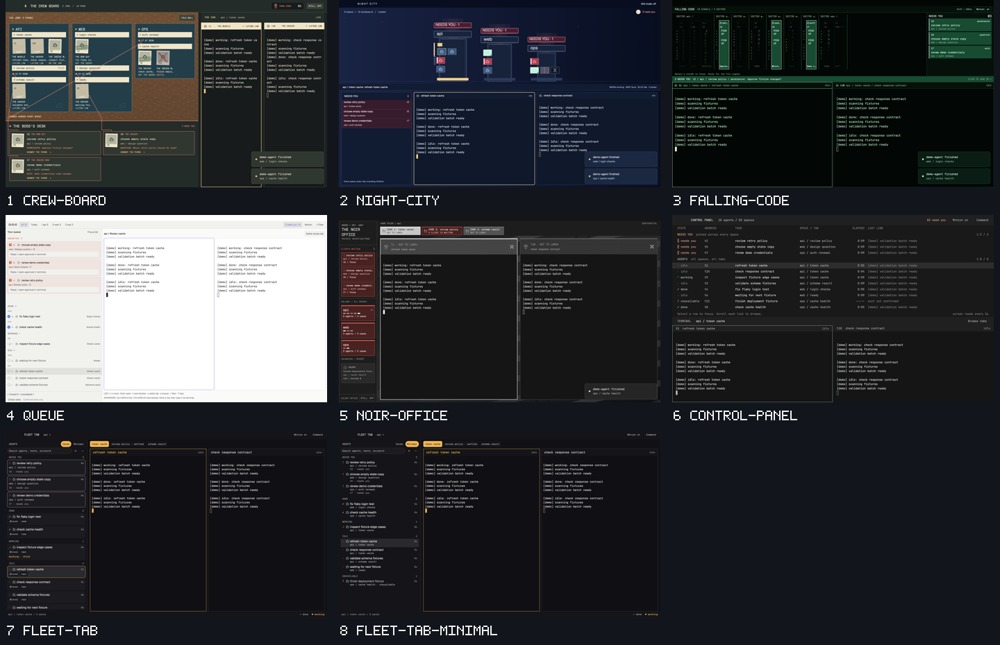

# Herdr layouts

Seven layouts for the Herdr app (0.1.7), each a complete folder you can install into an app home: a named layout, its own mod, a theme where it needs one, and a RECIPE.md that explains what you see, how it behaves and what it cannot do yet.

| Layout | In one line |
|---|---|
| [Crew Board](crew-board/) | A heist crew on a cork wall: jobs as blueprints, agents as instant photos, blockers on The Boss's Desk. |
| [Night City](night-city/) | Each space a tower, each tab a floor, each agent a lit window; red windows need you. |
| [Falling Code](falling-code/) | Every agent a column of green code; a call for help freezes into PICK UP. |
| [Queue](queue/) | An urgency ranked agent list beside the live terminals, with blockers always on top. |
| [Noir Office](noir-office/) | Frosted doors, case folders and venetian light; everything grey until someone needs you. |
| [Control Panel](control-panel/) | One strict monospace grid of every agent: state, task, elapsed time and last line. |
| [Fleet Tab](fleet-tab/) | A tab strip and named pane grid with an agent sidebar of cards, Group by and a minimal mode. |

Each folder has `preview.png` and a 12 second `demo.mp4` recorded live in the Herdr app; Fleet Tab adds `preview-minimal.png` and `demo-minimal.mp4` for its minimal sidebar.

## Install

Every layout installs into an app home you choose and never overwrites anything already there. Follow the Install steps in that layout's RECIPE.md: copy its `layouts/`, `themes/` and `mods/` entries only when the destination names are free, then pick the layout in the app.

## About the demo

The previews and videos show a demo scene of ten fake agents in three spaces (api, web, ops): three need you, two are done, one is working, one has exited and the rest are idle. No real work, people or data appear in them.
