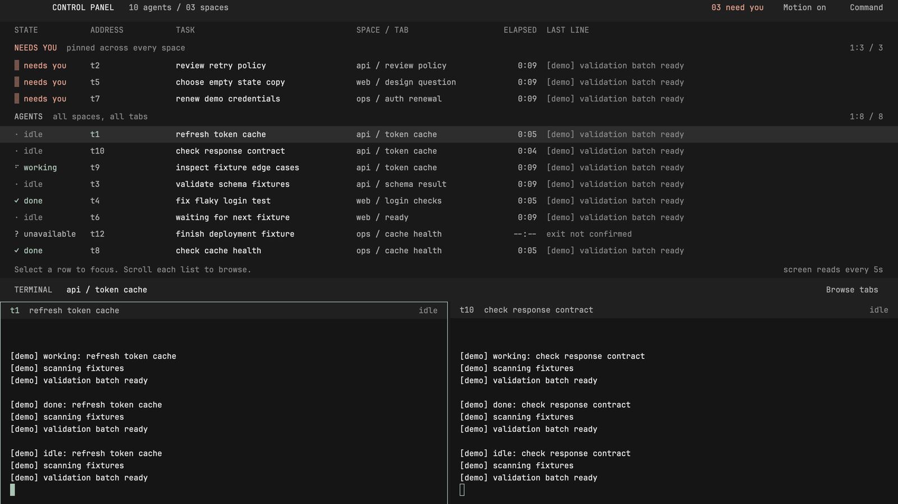

# Control Panel

A quiet, monospace overview of every agent across every space. Names, state, time and the last screen line share one strict grid. Agents waiting for you sit in a permanent band above the roster. The selected tab stays live below, with no wallpaper, decorative meters or invented progress.



Additional [1600x900](mods/control-panel/preview.svg) and [1000x700](mods/control-panel/preview-compact.svg) schematics document the grid with synthetic data. They are labelled offline and are not native captures.

## What you see

From top to bottom: a 48 px title bar; a 432 px overview beginning directly with column labels; a 40 px terminal context bar; then the active tab's real split tree. At 1600x900 the terminal region has 380 px; at 1000x700 it has 180 px, including its 28 px pane headers. The overview fits eleven rows, normally three pinned blockers plus eight other rows.

```text
  CONTROL PANEL   09 agents / 03 spaces       03 need you   Motion off
  STATE         ADDRESS      TASK          SPACE / TAB   ELAPSED  LAST LINE
  NEEDS YOU     pinned across every space
  ▓ needs you   t2           review policy api / review      6:23  Approve changes?
  ▓ needs you   t5           choose retry  web / design      2:41  Which policy?
  ▓ needs you   remote/t7    renew access  ops / auth        1:34  Renewal needed
  AGENTS        all spaces, all tabs
  ⠋ working     t1           token cache   api / tokens      3:14  Batch ready
  ✓ done        t4           login test    web / checks      0:42  14 passed
  · idle        t6           fixtures      web / checks      1:07  Waiting
  × exited      t12          schema audit  web / checks     --:--  exited (code 0)
  Select a row to focus. Scroll each list to browse.
  TERMINAL      api / token cache                          Browse tabs
  t1            refresh token cache                           working
  [the active tab's live terminals, including non-agent shells]
```

Type is bundled JetBrains Mono only, one size, `40 / 3` px (13.333333333333334). The inspected font has 600-unit nonzero advances at 1000 units/em, giving an 8 px cell at zoom 1. Rows are 28 px, outer padding 24 px, column gaps 16 px, and spacing is a multiple of 4 px. Each state glyph, including Check and the exit cross, sits in a clipped, non-shrinking 8 px box with equal minimum and maximum widths. The whole state cell is similarly fixed at 112 px (14 cells), so a fallback glyph cannot shift its label or the next column. The focus border is a 1 px hairline, not layout spacing. Numbers and elapsed values align right in fixed cells.

| Column | Below 1200 px, cells | At least 1200 px, cells |
| --- | ---: | ---: |
| State glyph and word | 14 | 14 |
| Address | 12 | 16 |
| Task, the terminal's title | 26 | 36 |
| Space / tab | 20 | 28 |
| Elapsed in state | 8 | 8 |
| Last line | Remaining whole cells, 29 at 1000 px | Remaining whole cells, 82 at 1600 px |

At intermediate widths, less than one cell of spare width stays at the right. Long text ends in an ellipsis; a hover tooltip preserves the complete identity and current cached line, including a 60-character title. The last-line column shows the last nonempty line from the last eight screen lines, with escape sequences removed. An empty screen says so.

The background is `#191919`, terminal background `#151515`, chrome `#202020`, text `#e4e4e4`, secondary text `#adadad`, and dim text `#888888`. The panel's sole accent is sage `#abc4b5`. Only blocked uses the allowed app `blocked` token, `#df9d89`. The one-accent rule governs the panel chrome, not terminal output: the 16 ANSI colors retain desaturated red, green, yellow, blue, magenta and cyan plus neutral shades, so errors, warnings, successes and diffs remain distinguishable. Normal red/green/yellow/blue are `#ac9898`, `#9aa49b`, `#b0aa9a` and `#9aa2ae`, with brighter counterparts for bold output. The app theme picker may override these colors.

## How it behaves

| State | Appearance and meaning |
| --- | --- |
| Working | A one-cell cell-motion Comet at 400 ms per frame, 2.5 updates/s, and `working`. |
| Blocked / core error | Breathe at 500 ms per frame, 2 updates/s, and `needs you`, in the pinned area. |
| Done | Still `✓ done` in the accent. Native unseen completion becomes idle when Herdr marks it seen. |
| Idle | Dim `· idle`, without motion. A raw child's done report says `· finished`; it is not claimed as native unseen completion. |
| Exited | Still `× exited`, neutral, only after a matching finished core record confirms it; the last-line slot shows exit reason/code. |
| Missing, unconfirmed | Still `? unavailable` and `exit not confirmed`. A failed check never invents an exit. |

Blockers are oldest-waiting first, independent of the selected space, settled tabs, roster position and focus. Each agent has one row: blocked agents move into the attention band instead of appearing twice. Other rows follow space, tab, then natural address order. Address is identity; `seq` is unused. Next/previous agent navigation follows the displayed grouping.

The attention band is always present. Up to four blockers fit at once; its own whole-row scroll and Prev/Next controls expose overflow with a persistent range/count. Scrolling the roster cannot move the band. The roster also scrolls in whole-row steps, preserving alignment and an exact set of visible rows. There is no virtual-list API. Hover carries full long names; all three required acceptance blockers fit at once.

Click a live pane agent to focus it and continue typing. Click a child without a pane to open Herdr's terminal peek. Exited and unavailable rows do not act. Browse tabs lists every space and tab, including settled tabs and shell-only tabs. Command opens the app's command palette. With no spaces, tabs or agents the panels show an explicit empty state.

Motion off persists in the mod's namespaced shared setting; animated glyphs use their resting frame. Inactive windows also use still glyphs and stop starting terminal reads, exit checks and clock redraws. Elapsed time updates once per second from a per-address state clock saved in the bounded history. An observed status change resets it to the current time; unchanged states retain their start across redraws and restarts. A valid `terminals().status_ms` is used only when newer than that stored start. With neither clock available, a working row starts from its tab's `working_since`, then `changed_at`; other rows use `changed_at`, with first observation as the final fallback. Tab timestamps are approximate because several agents can share a tab. The layout plays no custom sound; native Herdr notifications remain subject to the app's sound setting.

## Built from

- `layouts/control-panel.json` is a non-resizable column with `topbar`, `overview`, `livebar` and one `tab: active` block. Each pane has a 28 px `pane` header, including single-pane tabs.
- One namespaced mod, `mods/control-panel`, handles roles `topbar`, `overview`, `livebar`, `pane` and `tabs`. `model.js` contains pure joins, history, text sanitising, formatting and viewport calculations. No shipped mods are edited or used for custom regions.
- `themes/control-panel.json` supplies colors only. Fonts, layout dimensions and pane framing stay in the layout and mod.
- Data: `agents`, `terminals`, `spaces`, `panes`, `props`, `theme`, `window`, `layout`, `shared`, `setShared`, `setAgentOrder`; actions: `agent.focus`, `terminal.peek`, `pane.focus`, `space.select`, `tab.select`, `app.palette`, the three window commands, `openOverlay`, `closeOverlay`. See [API-AUDIT.md](API-AUDIT.md).
- The sole polling owner is the overview. It calls `hc(["read", address, "--lines", "8"])` for visible live rows only, no more often than every five seconds per continuously visible row. Requests are serial, with only one batch in flight. It checks visibility and activity before each call and after each reply. Cached screen text stays in memory and is discarded when the row leaves the polled viewport.
- A bounded 128-entry mod-local history remembers identity/location, observed status and state start, never screen output. Herdr 0.1.7 does not refresh `status_ms` on status events, so the persisted clock supplies elapsed time when that field is null or stale. Missing entries trigger `hc(["ls", "--all", "--json"])` at most once every 15 seconds while active. Only exact address matches with `state: "finished"` confirm an exit. Both calls inherit the app's core session. No session is pinned in shipped code; no network or telemetry is used.
- `scripts/bake-frames.mjs` imports the existing, read-only cell-motion `dist/terminal/index.js`. It calls `tui.bake(tui.cometCell(2.4), {frames: 6, seconds: 2.4})` and `tui.bake(tui.breathe(2.5), {frames: 5, seconds: 2.5})`. The output is `frames.json` plus an identical `frames.js` module, avoiding unconfirmed JSON import support in Herdr. Runtime motion uses native text `.frames`, not timers.
- cell-motion is MIT, version **0.1.0**, commit **e528cb6eb7b6e70d633480cf6d03be58be3abb47**. Check is only a React/SVG component in this version; the static `✓` is its resting terminal adaptation. There is no fabricated `tui.check()` API and no repeated completion animation. See [THIRD-PARTY-NOTICES.md](THIRD-PARTY-NOTICES.md).

## Watch out

- Node's fake API tests do not prove native loading, rendering or typing focus. Verify these in the installed app and use a real capture for `preview.png`.
- Hidden copies retain timers in Herdr. Polling checks the overview node and its ancestors, window activity, measured size and current rows. An already dispatched process cannot be cancelled by this API; its reply is discarded after deactivation or scrolling. Reads can take longer than five seconds when a terminal or remote machine is slow; this is a minimum interval, not a freshness guarantee.
- At widths below roughly 840 px, some columns can clip. Acceptance targets are 1000x700 and 1600x900 at zoom 1. More than four blockers require scrolling the dedicated pinned band; the label and count remain visible.
- The history starts observing when the layout is used. It cannot reconstruct agents that exited before observation or evicted entries. Remote exits remain unavailable unless the core reply supplies an exact qualified address; no remote exit is inferred from a local numeric suffix. Address reuse follows the app's address-based identity model.
- Native done belongs to `agents()`. Raw child completion is only a finished report. An unreported shell is absent from the roster and remains available in the live split tree and tab browser.
- Screen text is plain, not a miniature terminal emulator. ANSI/OSC/DCS control payloads are removed; wide characters use conservative cell widths, and complex emoji sequences can be truncated early. UI columns retain their fixed pixel bounds.

## Done when

- Offline: every JSON parses with `jq empty`; all JS/MJS passes `node --check`; `python3` compiles the installer; `node --experimental-vm-modules --test tests/*.test.mjs` passes.
- Offline tests cover joins, sorting, settled/remote/child blockers, 60-character titles, elapsed boundaries, escape removal, viewport isolation, inactive and hidden polling, asynchronous races, no output persistence, empty states, frame provenance, and refusing install collisions.
- Live: load the mod and capture 1600x900 and 1000x700 with ten mixed-state agents, three blocked including a settled and remote one, an unseen done, a child, an unreported shell and a confirmed exit. Find a hidden blocker within two seconds, focus it, type, then repeat with motion and sound off and long names. Save the actual capture as `preview.png`.

## Install without overwriting

1. Choose the existing app home where you want the layout installed. The mod executes the two read-only core commands disclosed above when it runs.
2. From this package directory, run `python3 scripts/install.py /absolute/path/to/chosen/app-home`. The destination is required; the installer never defaults to a personal configuration path.
3. The installer preflights all three names and refuses existing files, directories or dangling symlinks. Each file is opened exclusively, preventing a race from replacing another file. It copies only the layout, theme and mod. On a name clash, choose a fresh home or deliberately rename the package, layout/theme references and mod asset prefixes first.
4. Validate the installed mod with the app's native mod check, then select Control Panel in the layout picker. Existing layouts remain installed. Switch back with the app's usual layout shortcut.

For a manual copy without Python, first confirm that all three destination names below are absent, including files, folders and dangling symlinks. Then copy:

- `layouts/control-panel.json` into the app home's `layouts/` folder.
- `themes/control-panel.json` into its `themes/` folder.
- The whole `mods/control-panel/` folder into its `mods/` folder.

Do not merge or replace an existing destination. Cancel any replace/merge prompt and rename the layout, theme and mod consistently before trying again. Leave the recipe, previews at the package root, scripts and tests out of the app home. After copying, validate and select the layout as above.

To regenerate the kit frames, run `node scripts/bake-frames.mjs /path/to/cell-motion` against the existing matching build. It verifies version and commit and writes only here. No dependency install or build in cell-motion is required. `node scripts/render-preview.mjs` regenerates the two labelled schematics from generic fixtures.

## What is faked or missing

- The two SVG previews and test fixtures are explicitly synthetic demo data; runtime panels use real API data.
- Native loading, remote connectivity and typing focus require verification in the installed app; the offline tests and synthetic schematics do not establish them.
- Check uses a static terminal glyph adaptation because cell-motion 0.1.0 has no terminal Check generator. Comet and Breathe are genuinely baked from its existing terminal build.
- No token counts, costs, model names, task percentages or time-to-completion guesses are shown.
- The manual Motion toggle is supported; no undocumented operating-system reduced-motion API is assumed. Native sound remains app-controlled.
