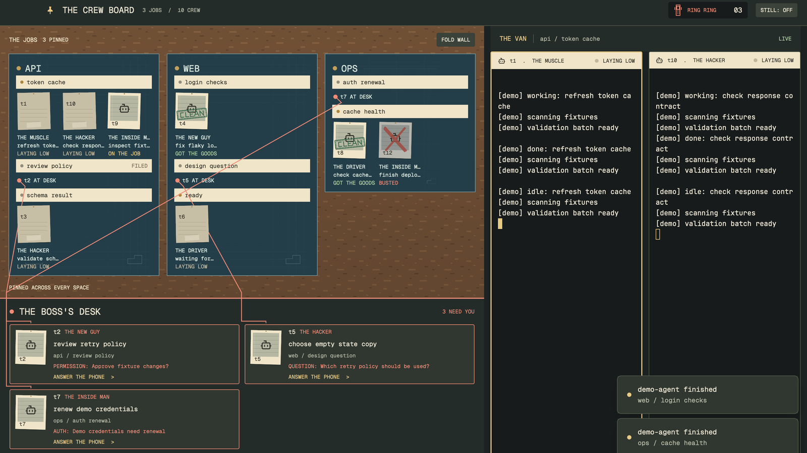

# The Crew Board

A heist crew pinned to a cork wall: jobs become blueprints, tabs become index cards, and agents become instant photos. Anyone who needs you moves to The Boss's Desk, while the active tab's real terminals stay in The Van. The burner phone tells you when to look down.

## What you see

- A 58px dark olive top bar, with The Crew Board, job and crew counts, a burner phone and a Still toggle. macOS traffic lights have their own 86px clearance. Other platforms get window controls.
- The cork wall takes three fifths of the remaining width. Each blueprint has solid blue paper `#243e49`, a `#7a999d` border and an inset grid image. Chalk is `#dce9df`; photo paper is warm `#f0e5c9`. Up to three jobs share a row, then wrap. The branch appears only when reported.
- Tab cards have brass pins when active and FILED marks when settled. Photos start at 92px wide. If the sheets would overflow, photos shrink to 64px with up to three per row before paging. Jobs with more than eight agents also use small photos. Empty tabs reserve only their index-card header. Compact sheets show short pins for requests already on the desk.
- Each tab initially shows eight crew entries, with a working +n expansion button. Page buttons and the wheel reveal further wall content. Readable text is at least 10px; each photo has a role, task title and state caption.
- The Boss's Desk is fixed below the wall, at least 280px wide, independent of wall paging and folding. Every blocked pane agent and reporting child is listed with title, workspace, tab, address and reported request kind/message. Age appears only when a timestamp is available. Long text has full-identity tooltips. Two request columns fit at wall widths of 760px or more, otherwise one. Overflow scrolls inside the desk, never with the wall.
- The Van takes the other two fifths, with a 420px minimum. One active-tab split tree holds genuine live terminals, paper tape headers and brass focus borders. Terminal text uses bundled JetBrains Mono 13px; interface text uses bundled Geist Mono.
- Below 1200px window width the wall becomes a 340px compact job/agent list, making room for terminals. The permanent desk remains. Fold Wall also switches scenery to this compact list; short wall space folds automatically.

## How it behaves

| State | Visible treatment |
| --- | --- |
| working | An upright photo sways 2px left/right over 2.4s. Caption: ON THE JOB. |
| done | A green CLEAN stamp settles onto the photo. Caption: GOT THE GOODS. Native unseen completion returns to idle after it is seen. |
| blocked / core error | NEEDS YOU on the desk; an empty red pin remains on the wall. RING alternates with RING RING every 1.6s. The desk shows kind and message only when reported. |
| idle | A plain photo back, with address and LAYING LOW. A raw child's reported done becomes idle, never native unseen done. |
| confirmed exit | A gray photo crossed out in red, captioned BUSTED. Right-click, then Burn It removes only the remembered card. |
| missing, unconfirmed | A faded photo with UNAVAILABLE. A missing record, offline machine or failed check is never treated as an exit. |

- Click a pane agent or desk request to focus its terminal. Children without panes open in a peek. No control sends input or answers a prompt. These controls create no keyboard focus handle, leaving typing with the selected terminal.
- Click an index card to select its space and tab. All settled tabs remain listed. Agent next/previous navigation follows the attention list first, then the remaining crew.
- Titles use the terminal agent title, then the joined agent report title, then program name, then address. Comic roles are stable address-based labels: THE HACKER, THE DRIVER, THE INSIDE MAN, THE FORGER, THE MUSCLE and THE NEW GUY.
- When both endpoints fit on screen, the same keyed photo springs in left/top between wall and desk. Red paths connect visible pins to the top edge of the matching request, descending through column margins and row gaps. They never pass through another request card. Compact mode and overflowing desks omit strings.
- Still turns off loops, frames, transitions and springs and persists. All motion also stops while the window is inactive. There are no animation timers or custom sounds. Herdr's own alerts follow the person's sound setting.

## Built from

- `layouts/crew-board.json`: a root column, topbar block, then a 3:2 row of wall and van. The van is a column with a rail and `{ "tab": "active" }`, with 31px tape headers. The wall's cork image belongs to its layout node.
- `mods/crew-board/main.js`: one namespaced mod, with `topbar`, `wall` and `header` roles, plus a small `burn` popup. The `desk()` region is inside the wall View, so strings never cross a mod boundary. The header role draws a van rail or the pane given by `props().pane`.
- `model.js` joins live agents and raw children by address, normalizes error to blocked, assigns comic roles, joins reported timestamps and keeps bounded exit history. `geometry.js` plans sheet dimensions and safe desk routes. `localStorage` remembers up to 128 recently observed agent records; `shared` stores still mode and removal events. Nothing reads the terminal screen.
- `themes/crew-board.json`: terminal colors, sixteen ANSI colors and semantic panel colors. The art is original SVG: cork, blueprint grid, photo frames, card back, CLEAN stamp, marker X, pin, phone, silhouette and settings schematic. No downloaded assets, external fonts or generated images.
- Data APIs: `agents`, `terminals`, `spaces`, `panes`, `props`, `theme`, `window`, `shared`, `setShared`, `setAgentOrder`. Commands: `agent.focus`, `terminal.peek`, `pane.focus`, `space.select`, `tab.select`, `layout.resize` and window controls. The popup uses `openOverlay` / `closeOverlay`.
- External program disclosure: the wall checks vanished remembered agents, at most once per five seconds while active and with no overlap, using `hc(["ls", "--all", "--json"])`. It confirms `state: "finished"` by full address, including remote prefixes. This reads core metadata only. There are no terminal-output reads, network requests from the mod or input sends. The app helper uses its configured core and inherited environment, with a 30s execution limit.

## Watch out

- Built against Herdr app 0.1.7. The mod inherits the running app's core connection; it embeds no session name.
- A terminal must have been seen by this wall to be remembered. The 128-record bound evicts oldest records. A machine disconnect is not evidence of an exit. Confirmed records survive restarts as long as Herdr keeps that mod copy's storage.
- Wall pages overlap by a full card. Only fully visible photos participate in transfer motion; the desk retains every request. Very large fleets scroll inside the desk. Captions and long names truncate visually, with complete text in tooltips.
- Role names are theatrical labels, not claims about what a program does. No progress, cost, token count or model identity is fabricated.
- Unreported shells appear in the active-tab split tree with a SHELL header and are not promoted to agents.
- Static fixtures verify JavaScript behavior and planned geometry. Native rendering, actual typing focus and animation must be checked in the app.

## Done when

- Every JSON passes `jq empty`; all mod scripts pass `node --input-type=module --check` from stdin.
- `node crew-board/tests/model.test.mjs`, `node crew-board/tests/geometry.test.mjs` and `node crew-board/tests/view.test.mjs` pass.
- `herdr-app check <app-home>/mods/crew-board` passes and the app home has no `*.error` files.
- At 1600x900, three jobs with eight tabs and eleven crew records, including a child and a remembered exit, fit on one wall page. At 1000x700, the compact roster and permanent desk remain usable.
- Working, unseen done, needs you, idle, confirmed exit, settled and remote blockers, children and shells show correctly. Clicking a hidden blocker finds it within two seconds and leaves its terminal ready for typing. Repeat with long names, still mode and sounds off.
- Missing timestamps produce no age label; empty roles render without errors; strings avoid request-card interiors.

## Install

Read this recipe and the mod files first, including the external-program disclosure. Choose the Herdr app home where you want to install the layout.

1. Verify the destination has no `layouts/crew-board.json`, `themes/crew-board.json` or `mods/crew-board` entry. If a name is taken, rename the complete package, including all mod, asset, theme and layout references. Never overwrite an existing package.
2. Copy the layout JSON, theme JSON and complete `mods/crew-board/` directory into the same relative paths in the app home. Leave tests, recipe, audit and root preview out. The SVG schematic inside the mod supplies the settings preview.
3. Run `herdr-app check <app-home>/mods/crew-board`, then select Crew Board in the layout switcher, or use `layout.switch {name: "crew-board"}`.
4. Your previous layout remains available in the switcher. To uninstall, switch away and remove only this package's installed layout, theme and mod directory.

## What is faked or missing

- The art and crew roles are theatrical; displayed status, request text, task title and location come from live APIs.
- The phone buzz is omitted to avoid duplicating Herdr's own alert. Bundled Geist Mono replaces a marker font; original SVG textures replace photographs.
- The settings preview is a schematic. The root `preview.png` is the gallery image.
- Compact views use a text roster without photo transfer or strings. Overflow uses independent desk scrolling with stationary photos. Newly observed or off-page requests appear directly on the desk when their source photo is not mounted.
