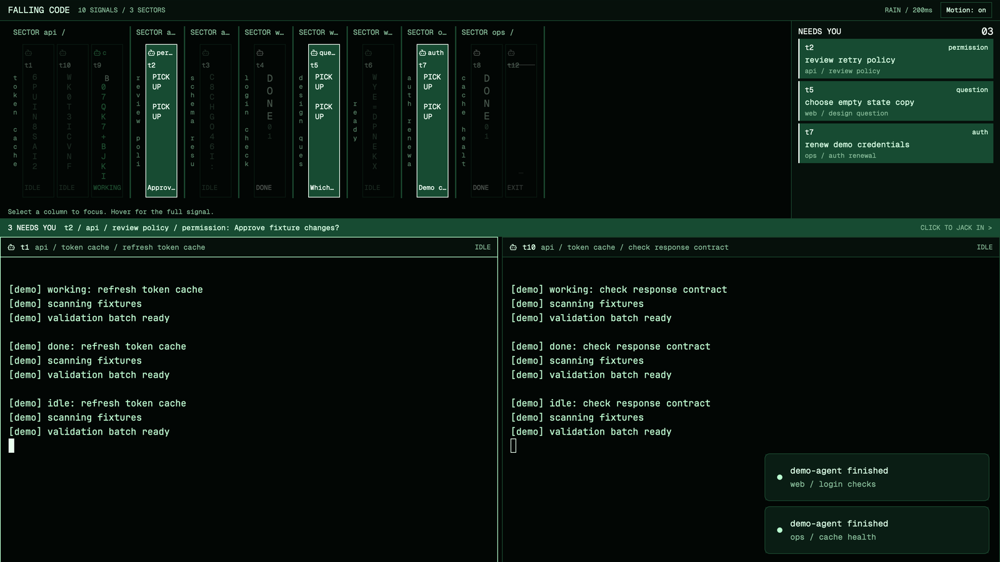

# Falling Code

Every reporting agent is a narrow column of phosphor green code. A call for help freezes its column into white PICK UP letters, dims the other columns and puts its full identity in a permanent NEEDS YOU area. Your active tab stays live in the terminals below.

## What you see

1. The rain field takes 40% of the height remaining after the alert strip, with a 250px minimum. A 32px bar names Falling Code, counts reporting agents and sectors, and offers Motion: on/off. The system title bar stays available.
2. Workspaces become sectors, labelled with their real name and reported branch. Each tab is a narrow vertical name divider. Columns are 48px wide, separated by 4px; they show the program icon, terminal address and state. Groups wrap into another band before 20 columns, or sooner if the available width requires it. The field scrolls vertically at higher counts. All readable text is at least 10px.
3. NEEDS YOU is a permanent 316px area at the right of the rain field. Every live blocker has its title, address, sector, tab and reported kind here, including settled tabs, remote agents and children without panes. It has its own scrolling and never follows the rain field's scroll position. Three 60px rows fit at the target 1000x700 size. Long names truncate visibly; hovering shows the complete identity and first message line.
4. A 28px alert strip shows the first blocker, reported question and a focus action. With no blockers it names the active sector and tab.
5. The lower 60% is one active-tab split tree, with 30px headers, green 1px borders and a brighter focused border. Its terminal background is 92% opaque over a solid near-black canvas. Fonts are the bundled Geist Mono and JetBrains Mono.

Colors: near-black `#020604`, green `#59e58c`, muted green `#83b795`, white `#f1fff5` for attention. `theme()` supplies panel colors so a theme choice can override this palette. The package includes its own color-only theme.

## How it behaves

- Working: a fixed white leading glyph and eight precomputed, seeded text frames, 200ms per frame. There is no animation timer in JavaScript.
- Done: white D O N E vertically, with dim green glyphs underneath. This is native unseen done from `agents()`; looking at the agent lets Herdr turn it idle. A raw child's finished report is idle, never native unseen done.
- Needs you: core error counts as blocked. A white-on-green column freezes into PICK UP; its head shows the reported kind and its foot the first line of the reported message, clipped to its width. All other columns fade to 30% over 600ms. The full identity, kind and message are also available on hover; the alert strip repeats the first call.
- Idle: static dim glyphs, with no animation.
- Dead: only an explicitly confirmed finished core record gets EXIT, a struck address, a 900ms downward glyph drain and a slow underscore pulse. At most 64 previously observed agents are remembered. A missing record, unavailable machine or failed check shows UNAVAILABLE and `?`, never a claimed exit.
- Click a live pane agent or attention row to run `agent.focus`. Click a pane-less child to run `terminal.peek`; nothing types or answers its prompt. Click a sector or tab divider to select it, or a terminal header to focus its pane. Hovering never takes keyboard focus. Dead and unavailable columns have no focus action.
- Motion: off is persistent and removes frames, transitions and cursor pulses. Motion also pauses when `window().active` is false. No custom sound is played; Herdr remains the sole source of standard alerts and obeys its normal sound settings. There are no custom key bindings.
- Pane-agent names use the terminal title, then its reported title joined by address, then program name, then address. Full names remain in tooltips. No elapsed-time badge or placeholder is drawn.

## Built from

- `layouts/falling-code.json`: root column with a solid near-black background, named theme, bundled fonts and root `terminal_opacity: 0.92`. Its children are `rain` weight 2, `alert` 28px and `{ "tab": "active" }` weight 3. The same mod supplies every pane header.
- `mods/falling-code/main.js`: a single namespaced mod selected by `props().role`, `rain`, `alert` or `header`. Its manifest is `place: "none"`. It does not replace any shipped mod.
- `model.js`: address-based agent joins, error normalization, nested raw children, bounded history, seeded frame preparation and wrapping. No identity depends on `seq`. Unreported shells stay out of the rain and get UNREPORTED headers.
- Data: `agents`, `terminals`, `spaces`, `panes`, `machines`, `window`, `theme`, `props`, `shared`, `setShared`, `setAgentOrder`, `run`, `hc`, and per-copy `localStorage`. `cx.timer.every(10000)` only checks missing-agent history. Live app data is never polled for rendering.
- Program disclosure: the rain copy runs read-only `hc ls --all --json` only while a remembered agent is missing, at most once per 10 seconds. It uses the documented `hc()` helper and inherits the app's environment and session. No session is pinned in shipped code. No network, external file reads, custom audio or process mutations are used.
- Art: `layouts/falling-code.svg` is an original hand-written illustrative settings thumbnail. No downloaded art, audio or fonts. Program icons are referenced from Herdr's own program table.
- [API-CHECK.md](API-CHECK.md) records the local 0.1.7 API audit and validation boundary. `checks/` contains offline model and behavior fixtures; they are not installed as mods.

## Watch out

- In the 0.1.7 headless check, `window()` can be null even though its type declares an object. A missing window is treated as inactive. Every role supports no spaces, no focused tab and zero agents; 60-character titles keep their full value in tooltips.
- Native drawing, GPU cost, focus retention during typing, and fitting at 1600x900/1000x700 require direct runtime checks. A Node fixture cannot prove these.
- The rain field needs explicit full-height sizing inside its horizontal row; default `h_flex` centers children and can collapse the scroll region. Keep `h_full()` on the field column and stretch the row when changing the composition.
- With many tabs, sector headers repeat for each tab fragment; a fragment repeats after wrapping. Very large counts need vertical scrolling. Attention remains separate and has no folded or filtered mode.
- History starts from agents the mod has actually observed; it cannot reconstruct every agent that exited before installation. A disconnected core is unavailable, not dead. History is retained for the newest 64 observed addresses across reloads in this app home.
- Use one rain-role copy per layout. It owns history and exit checks; alert and pane copies do not poll or play sounds. Do not change the home/session while an app instance is running.

## Done when

- Every JSON passes `jq empty`; both mod scripts and both check scripts pass `node --check`.
- `node checks/verify.mjs` passes 20-column packing, deterministic frames, status/title/timestamp joins, raw child error, native done, shell exclusion, bounded history, unavailable states and package hygiene.
- `node checks/render-fixture.mjs` passes all three roles, hidden/remote/child attention and click routing, 200ms frames, still/inactive modes and an inherited-session exit query. It also covers every role with an empty model and null window, and with one 60-character title. These are static fixtures only.
- `herdr-app check` passes in the chosen app profile and there are no error files. At 1600x900 and 1000x700, show ten agents across multiple sectors and tabs, including three blockers, a pane-less child, unseen done and a confirmed exit. Find and focus a hidden blocker, keep typing, and repeat with long names and motion/sounds off.

## Install

Read every package file first. The only program run by the installed mod is the read-only core history query disclosed above. Copy into a deliberately chosen app home, never over an existing layout, mod or theme.

With the app stopped, choose its app home. Refuse installation if any of these names already exists there: `layouts/falling-code.json`, `layouts/falling-code.svg`, `mods/falling-code`, `themes/falling-code.json`. Then copy the two files from `layouts/`, the entire `mods/falling-code/` folder and the theme file into their matching directories. Leave the recipe, audit, checks, package metadata and preview out of the app home. If a name clashes, rename all matching layout, theme, mod and asset references consistently before copying.

Check the mod in that app profile, select Falling Code in Settings and verify the Done when list.

## What is faked or missing

- No fake live agents, fabricated progress, model names, costs or counters. Demo records appear only in offline checks.
- Katakana-like glyphs use the permitted plain digits/Latin fallback and bundled fonts.
- The optional payphone ring is omitted. The app's existing alerts are the single sound source.
- The terminal canvas is solid. The invisible still-rain texture was removed; the rain field supplies the visual effect. The settings illustration is artwork, not runtime evidence.
