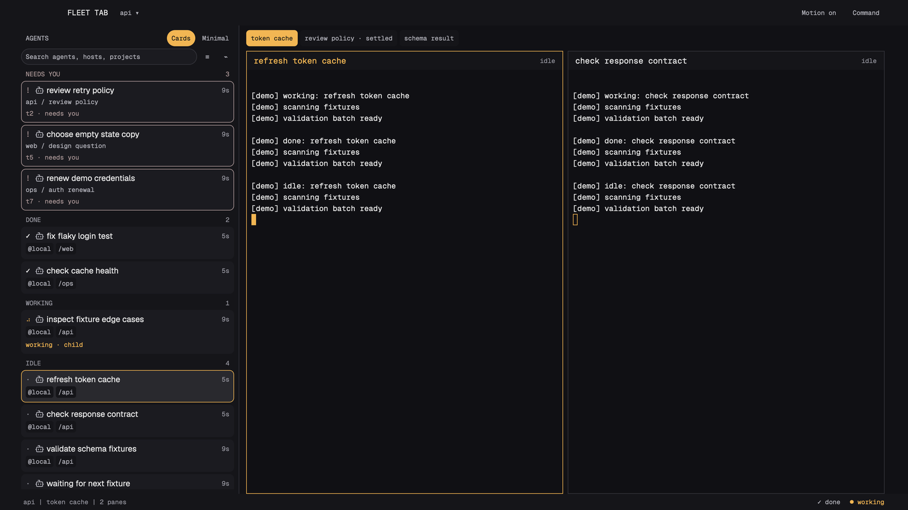
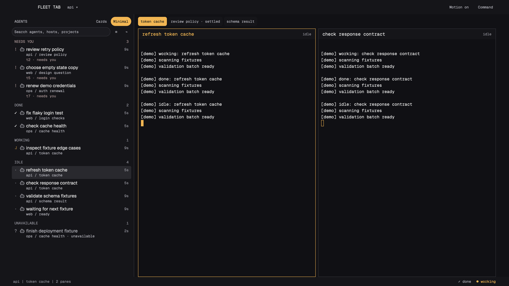

# Fleet Tab

A dark, quiet workspace for a fleet of agents: an amber active tab pill, bold pane headers and a live terminal grid, with a compact agent list on the left. Rounded cards carry the agent's name and reported details; Minimal keeps just the essentials. Agents waiting for you stay in a separate pinned group above the list, across every space and tab.





## What you see

The 44 px window bar contains Fleet Tab, a space picker, Motion and Command. The sidebar is 320 px below 1200 logical px window width, otherwise 384 px. A 44 px tab strip sits above the existing split tree; pane headers remain 32 px, and the bottom status bar remains 28 px. Tab, pane and status content share 12 px outer gutters. The grid follows the user's splits without rearranging them.

Cards mode, with compact bordered cards and quiet chips:

```text
 FLEET TAB    api v                                Motion off  Command
 AGENTS             (Cards) Minimal | lead research (build) docs
 (Search agents, hosts, projects) = ~| +--------------+---------------+
 NEEDS YOU                        3 | | token cache  | login test    |
 +--------------------------------+ | | working      | done          |
 | ! icon choose retry policy  2m | | | real terminal| real terminal |
 | api / review                   | | +--------------+---------------+
 | t2 . needs you                 | |
 +--------------------------------+ |
 [two more pinned cards]            |
 WORKING                          2 |
 +--------------------------------+ |
 | . icon refresh cache        4m | |
 | @local /service model-name      | |
 | working . progress 26%          | |
 +--------------------------------+ |
 DONE                             1 |
 | check icon login test        1m | |
 | @local /service                 | |
 api | build | 4 panes                                     done working
```

Minimal mode uses the same columns and selection tint, with no row borders:

```text
 AGENTS             Cards (Minimal)
 (Search agents, hosts, projects) = ~
 NEEDS YOU                        3
 ! icon choose retry policy     2m
        api / review
        t2 . needs you
 [two more pinned rows]
 DONE                             1
 check icon login test          1m
        api / checks
 WORKING                          2
 . icon refresh cache           4m
        api / build . progress 26%
 IDLE                             1
 . icon documentation           8m
        docs / notes
```

The sketches use synthetic names and values only. Runtime panels never insert sample data. Long text ellipsizes; hover preserves full identity, model and reported progress. Minimal keeps its workspace/tab and any extra state detail on the second line, indented under the title; blockers retain a separate visible address line. All Cards metadata, including pinned space/tab and address lines, is flush at the card inset. Chips hug their content and shrink with ellipsis when needed.

The single source of spacing is `mods/fleet-tab/spacing.js`. Every dimension in the renderer references it. `node scripts/layout.mjs` generates the static layout JSON from the same values; the tests enforce parity. Geometry is logical px at zoom 1:

| Token or derived role | px | Where used |
| --- | ---: | --- |
| unit / gap | 4 | Icon spacing, card row gaps, mode/search gap |
| nudge | 2 | Chip vertical inset; half-step for existing tab radius |
| inset / cardInset | 8 | Sidebar edge, card content inset, control horizontal inset |
| gutter | 12 | Tab strip, pane grid, pane header and status outer gutters |
| line / icon | 16 | Every text line box and program icon |
| state | 12 | Fixed status glyph column |
| elapsed | 32 | Fixed right-aligned elapsed and group-count column |
| titleInset | 36 | Minimal second/third lines only; Cards metadata stays flush at the card inset |
| minimalPad | 4 | Minimal row top/bottom padding |
| cardInset minus stroke | 7 + 1 | Inner padding plus border equals the 8 px card inset |
| headerTop / headerBottom | 8 / 4 | Group hierarchy, more space above than below |
| headerHeight | 28 | Header padding plus one 16 px line |
| control | 28 | Search, mode toggles, filter/activity buttons |
| inset minus stroke | 7 + 1 | Search inner inset plus border aligns its text with headers and row glyphs |
| chip | 20 | 16 px text with 2 px vertical inset; 4 px horizontal inset |
| minimalRadius / cardRadius | 4 / 8 | Quiet full-width Minimal selection, rounded Cards |
| pillRadius / tabRadius | 16 / 6 | Search and sidebar controls (clamped to half height), existing tabs |
| rowHeight, Minimal | 40 / 56 | Two-line row / pinned three-line row, no interline gap or border |
| rowHeight, Cards | 56 / 76 / 72 | Basic / extra detail / pinned, 4 px interline gap |
| rowGap, Minimal / Cards | 0 / 4 | Between adjacent rows |
| rowsHeight, three pinned | 168 / 224 | Minimal / Cards, includes all inter-row gaps |
| topbar / tabbar / paneHeader / statusbar | 44 / 44 / 32 / 28 | Existing workspace bands |
| topbarInset / statusGap / popupInset | 16 / 16 / 16 | Non-mac topbar inset, status gap, activity popup inset |
| menuRow | 32 | Group menu rows |
| stroke | 1 | Card and pane hairlines, separate from spacing rhythm |

Typography remains Geist Mono everywhere except Geist sidebar titles, with just 11, 13 and 14 px. Every UI text line explicitly uses `line_height("16px")`; terminal text remains 13 px. Titles are 14 px semibold and metadata is 11 px. Search, icon and title rows share fixed line boxes; elapsed never steals width from another row.

Palette remains terminal `#101014`, canvas `#111115`, chrome `#151519`, cards `#1b1b20`, border `#34343b`, foreground `#e6e6e6`, muted `#b2b2ba`, secondary `#96969f`, amber `#f2b653`. Blocked uses the app token. Minimal selection is a full-width tint with a 4 px radius, without a card border. Cards keep their border and focused amber edge. Done and idle stay neutral; terminal ANSI colors preserve subdued semantic colors. Tintable program icons stay grey; other artwork falls back to its program initial.

Chips remain honest: host is space.machine or local; project is its folder basename or name; a model requires `model: name` or `model=name` in the report title/message; progress requires valid numeric report.progress from 0 to 100. Titles fall through address-only values to report title, program and finally address. Cards only add a detail line for progress, a child marker, an exit code, or Host/Project grouping.

## How it behaves

| State | Both sidebar modes | Pane grid |
| --- | --- | --- |
| Needs you (`blocked`, raw `error`) | Pinned NEEDS YOU group, app blocked color, title, space, tab and address; never filtered or regrouped | Bold title and `needs you`; the actual terminal owns its prompt |
| Working | WORKING group, amber native text spinner or static dot, observed elapsed; optional reported progress | `working`, actual terminal, amber border when focused |
| Done | DONE group and check, elapsed in state; native unseen finish becomes idle when seen | `done` until the app marks it seen |
| Idle | IDLE group, neutral dot and elapsed | `idle` |
| Raw child finished | IDLE, explicitly `finished (child)`; not native unseen done | No pane unless the user gives it one; clicking opens peek |
| Confirmed exit | ARCHIVED, `exited` and exit code when known; elapsed since disappearance was observed | Core closes its pane |
| Unconfirmed loss | UNAVAILABLE; never called archived or dead | No synthetic replacement pane |
| Unreported shell | Absent from the agent list | Remains live, header says `shell` |

Search matches title, host, project, space, tab and address. The adjacent group button opens Status, Host and Project with the current choice checked. Confirmed archives and unavailable records stay in distinct groups. The activity button shows current live state counts across all spaces. Cards/Minimal, grouping and Motion persist across restarts. Both list modes use plain scrolling columns. The pinned group has its own scroll area for overflow, independent of the roster; its label and count never scroll away. At the target sizes three pinned blockers reserve 168 px in Minimal or 224 px in Cards. Larger sets scroll within the pinned group; its 48 percent cap snaps to whole rows, so the resting viewport does not clip a card. Its height uses the same row and gap tokens as the rows themselves.

Click a live pane agent to focus its terminal; click a raw child to open peek. No control answers a prompt. Settled tabs remain in the tab strip, labelled settled; the space picker reaches every tab. Existing app keyboard shortcuts remain available, and next/previous agent order follows the visible list with blockers first. The input does not grab focus on render or install. The pane header focuses its exact pane.

Elapsed is time in the observed state, not total task runtime. A persisted mod-local clock resets on state transitions, accepts a newer valid native timestamp, and initially uses the tab's working_since / changed_at or the observation time. A title or progress update alone does not reset it. Archived and unavailable ages mean time since disappearance was first observed. The one-second data clock pauses while the window is inactive. Working uses native text frames at 400 ms per frame (2.5 changes per second), with Motion off and inactive windows showing the static dot. There is no custom sound; the app's sound setting controls its normal alerts.

## Built from

- `layouts/fleet-tab.json`: root column, topbar block, body row (sidebar block plus workspace column of tabs and one `tab: active` block), status block. Pane frames invoke the same mod with `role: pane`.
- `mods/fleet-tab/main.js`: one namespaced mod with sidebar, topbar, tabs, pane, status, group, activity and spaces roles. `model.js` owns collection, data rules, grouping, clocks, history and navigation decisions. `spacing.js` owns the scale and computed row/reservation geometry; `scripts/layout.mjs` emits the layout from those tokens. `mod.json` uses `place: none`. No shipped mods are modified or required for drawing these regions.
- `themes/fleet-tab.json`: colors only. Program glyphs use the app's icon table. Working frames are a small inline braille sequence; no motion library or external assets are needed.
- Data: agents, terminals, spaces, panes, focused, theme, window and props. Actions: agent.focus, terminal.peek, pane.focus, space.select, tab.select, layout.resize, app.palette and window controls. The full-width topbar's on_size_change sets the sidebar width only when the 1200 px breakpoint is crossed, or at its first measurement. Inputs and popups use documented mod APIs. See [API-AUDIT.md](API-AUDIT.md).
- The sidebar alone remembers up to 128 agent records in per-copy localStorage, excluding terminal output. Preferences use namespaced shared state. Only missing remembered entries trigger `hc(["ls", "--all", "--json"])`, no more often than every 15 seconds while active, with at most one request in flight. Only an exact address with state `finished` confirms an exit. Replies are checked against the current live set. The call inherits the app's session; no session is pinned. No network, external file reads, screen polling, telemetry or custom sounds.

## Watch out

- Designed for 1000x700, 1512x882 and 1600x900 at zoom 1. Sidebar width is 320 px below 1200 logical px window width, otherwise 384 px, in both Cards and Minimal so switching modes does not move the terminal grid. Smaller windows or increased zoom reduce the room available for the roster and terminal splits.
- History starts when this layout observes agents. It cannot reconstruct earlier exits or evicted entries. Remote exits remain unavailable unless the core returns the exact qualified address. Address reuse follows the app's address identity model. Raw child ancestry is followed with cycle detection; no `seq` identity is used.
- Status timestamps from the app may be stale. The local clock is an observed-state clock; tab timestamps are a fallback, not a claim of exact per-agent work duration.
- An already dispatched core read cannot be cancelled by the mod API. Closed-copy replies are ignored. Hidden sidebar copies retain the app's timers; window activity gates the data clock and exit checks.
- Models reported without an explicit model marker are deliberately omitted rather than guessed. Missing progress is not zero. Historical model/progress chips are omitted, avoiding a stale claim about a finished or unavailable process.
- Node API doubles cannot prove native geometry, native input behavior or typing focus. Specifically, verify the styled search Input chain, popup sizes and space-picker button truncation in the app, using the shipped prompt mod as the input reference. The package root's `preview.png` is reserved for a real app capture, not a fabricated screenshot.

## Done when

- Every JSON passes `jq empty`, every JS/MJS passes `node --check`, and `node --experimental-vm-modules --test tests/*.test.mjs` passes from this package directory.
- Offline tests cover all three groupings, search-proof pinned local/settled/remote/child blockers, persistent controls, model/progress gating, state clock changes/reload, bounded history and exact exit confirmation, asynchronous revival, empty views, long titles, focus targets, still/inactive behavior and install collisions. Spacing tests reject literal renderer dimensions, verify generated layout parity, account for line boxes/padding/borders/gaps, and prove three blockers fit in both modes at the target sizes.
- Native acceptance: load the mod, then capture 1600x900 and 1000x700 with ten agents across multiple spaces/tabs, three blockers including a settled tab and remote, a child without a pane, an unreported shell, unseen done and a confirmed exit. Find each hidden blocker within two seconds; focus and keep typing. Repeat in Minimal, with an unmatched search, each grouping, long names, and motion/sound off. Save real Cards and Minimal captures as `preview.png` and `preview-minimal.png`, and record both modes.

## Install without overwriting

1. Read this recipe and the runtime files. The mod runs the read-only core history command disclosed above when remembered agents disappear.
2. Choose an existing app home. From this package directory run `python3 scripts/install.py /absolute/path/to/chosen/app-home`. There is no default destination. The installer refuses occupied layout, theme and mod names, including dangling symlinks, and creates files exclusively.
3. Alternatively, manually copy `layouts/fleet-tab.json`, `themes/fleet-tab.json` and the whole `mods/fleet-tab/` into the corresponding folders in the chosen app home. First confirm that all three destination names are absent; cancel any replace or merge prompt. Never merge a mod directory.
4. If a name is taken, use another app home or rename the package's layout, theme and mod consistently, including all `fleet-tab` mod names, popup references, theme references and persisted state keys. Keep recipe, tests and scripts out of the installed app home.
5. Validate the installed mod with the app's native mod check, then choose Fleet Tab in the layout picker. Switching back leaves all existing layouts available.

## What is faked or missing

- Test fixtures and ASCII sketches use synthetic examples. Runtime data comes from the app; no agent, model, progress, host or activity is fabricated.
- `preview.png`, `preview-minimal.png`, native loading, rendering at the target sizes and sustained keyboard focus are not verified by offline tests. They require an actual installed-app capture and check.
- No forced grid reflow: the active tab's existing split tree is preserved. No output excerpts, costs, token counts, context-use percentages or inferred model names.
- No operating-system reduced-motion API is assumed; the persistent Motion toggle supplies still mode. A multicolor program image is represented by its initial if no tintable icon exists.
