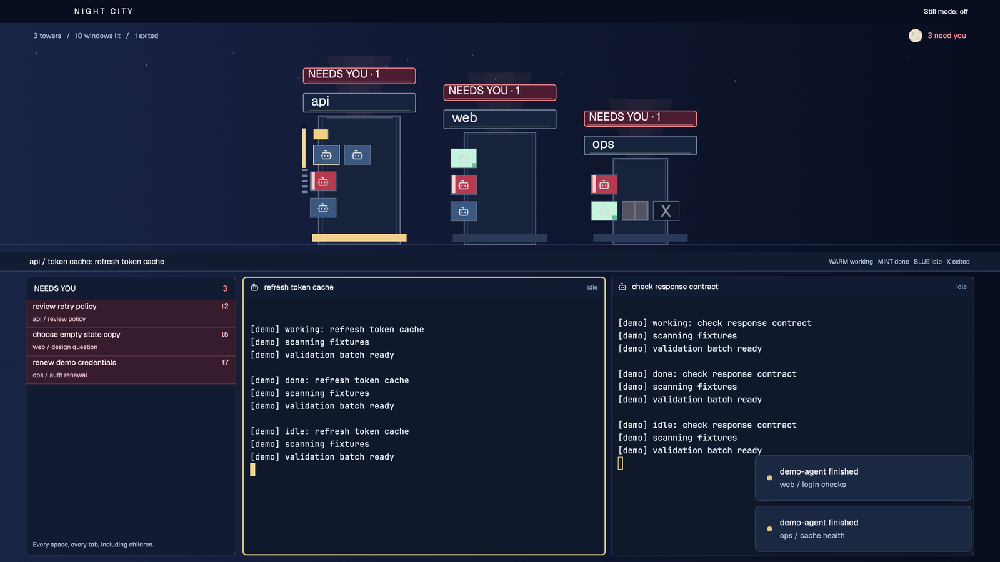

# Night City

A fleet becomes a skyline on an indigo night. Each space is a tower, each tab a floor and each pane a window. Warm windows are working, mint ones have finished unseen, and red windows need you. Click a window to enter its apartment below. A permanent NEEDS YOU rail on the left names blockers across every space and tab, including children without panes.

## What you see

- A 36px draggable title strip leaves room for macOS traffic lights and provides window controls where needed, plus a Still mode button. Type uses bundled Geist and JetBrains Mono, with 13px terminal text. All readable labels are at least 10px.
- The skyline takes weight 0.8 of the height remaining after the fixed strips, bounded to 180 to 360px. An indigo gradient (`#192344` to `#080e20`) and small static stars sit behind the buildings. A moon carries the live blocker count.
- Towers, floors, windows, signs and icons enlarge together by a factor between 1 and 2.5 to fit the skyline band. The fit reserves 40px for its count strip, 24px of vertical margin and 48px of horizontal margin, and includes roof height, gaps and any river. Sparse cities sit centred on a horizon; crowded cities keep 1x geometry and scroll instead of shrinking.
- Before scaling, towers start at 104px wide, grow by 24px per tab plus 16px, and widen further if 10px windows would overlap. Floors start at 24px high, plus 12px of attic headroom per descendant in the largest ladder on that floor. Glass is 18px tall and 10 to 24px wide, with 4px gaps. Tower height also grows by 3px per pane, up to 60px. The selected tower has a warm lobby and the selected floor a bright edge. Settled floors have hatch marks, never an opaque blind over a blocker.
- Remote spaces follow a river and bridge on the right, 92px wide before scaling. Their facades are dimmer; blocked windows, signs and attention identities retain full contrast. Rooftop signs show space names. Full window identity is available on hover.
- A 30px street strip names the current space, tab and focused task. Below it, a permanent 330px NEEDS YOU rail sits to the left of the active-tab terminals, away from bottom-right notifications. It has 44px identity rows with title, space, tab and address. Terminal frames have 30px headers, 8px gaps and warm focus outlines.
- The skyline scrolls horizontally or vertically when needed. The attention rail scrolls independently; three blocker rows fit at both 1600x900 and 1000x700.

## How it behaves

| State | Window and identity | Motion |
| --- | --- | --- |
| working | warm yellow `#f1cf83`, program silhouette | two typing text frames, 600ms, when the window has room |
| done | mint-white `#c5f4dc`, green sill lamp; native unseen completion | none; becomes idle when seen |
| needs you | red glass, static NEEDS YOU rooftop sign, named attention row and moon count | lamp pulses over 1800ms for only the three most recent blockers; roof beam pulses slowly; sign height transitions over 300ms |
| idle | cool dim blue glass | none |
| dead | dark glass with a grey boarded X, only after a positive finished record | none; its floor background goes dark after ten minutes |
| unavailable | grey-blue glass with a question mark and explanatory hover | none; absence or a failed check never proves death |

- Clicking a pane agent calls `agent.focus`, switching to its space and tab and focusing its terminal. A shell or mod window focuses its pane. Clicking an empty floor selects that space and tab; a rooftop selects the space.
- Children come from raw terminal `parent` links, including nested descendants. They form attic ladders above their ancestor's pane. Clicking a child or its attention row opens `terminal.peek`. A raw child `error` counts as needs you; raw child `done` becomes idle, not native unseen done. Unreported shells have curtains and mod panes have frosted glass.
- Titles prefer the agent's title, then its raw terminal's reported title joined by address, then program name, then address. Long labels truncate with full identity on hover; addresses remain beside attention titles. No elapsed value is displayed. Native `status_ms` values only order blockers by recency.
- No filter or fold hides blockers from the attention rail. Standard agent navigation follows pane-agent skyline order.
- Still mode persists through `shared("night-city.still")`. It removes every animation and preserves every status cue. Motion also pauses when the window is inactive. A ten-second data timer checks remembered exits and aging only while active; it never drives animation.
- Sound uses the app's existing alerts and sounds setting. The mod never calls `playSound`, answers prompts or sends terminal input.

## Built from

- `layouts/night-city.json`: root column, title strip, skyline block, street rail and a lower row containing the attention block first and exactly one `{tab:"active"}` tree second. Theme `night-city`, terminal opacity 0.92, illustrated settings thumbnail at `layouts/night-city.svg`.
- One namespaced mod in `mods/night-city/`: default role draws skyline; `role:"rail"` draws street, `part:"title"` or `part:"attention"`; `role:"pane"` draws headers. `model.js` maps native data, title fallbacks, descendants, bounded history, confirmed exits and skyline geometry. No shipped mod is edited or repackaged.
- Data/API: `agents`, `spaces`, `panes`, `terminals`, `focused`, `props`, `theme`, `window`, `shared`, `setShared`, `setAgentOrder`, `run`, `exec`; plus per-copy `localStorage`, `cx.spawn`, `cx.notify`, `cx.timer.every`. Commands: `agent.focus`, `terminal.peek`, `pane.focus`, `space.select`, `tab.select`, `window.minimize`, `window.maximize`, `window.close`.
- Program execution disclosure: when a remembered agent disappears, only the skyline copy runs `hc ls --all --json`, at most once per ten seconds, with one check in flight. It inherits the app process environment and core session. The listing includes connected machines with qualified addresses. No terminal text is read and there are no direct network requests.
- History keeps at most 64 observed agents for 24 hours in mod storage, keyed by exact address. A matching `state:"finished"` record confirms death. Missing, malformed or failed responses show unavailable.
- Five original hand-written SVGs: tower body, rooftop sign, neon sign, search beam and moon. Static stars, horizon, bridge, curtains, frosting and boarded X use native elements. Program icons come from the app. No downloaded art, external fonts or custom sound files.
- `API.md` records the herdr-app 0.1.7 authority and validation limits. `verify.mjs` runs offline fixtures without starting the app or core.

## Watch out

- Native rendering, font metrics, focus delivery and scrolling need an actual app inspection. Passing the Node fixtures does not establish those outcomes.
- With no selected space, tab, pane or agent, skyline and attention show empty messages and the street says No space / No tab. A header with no matching pane renders empty. These paths tolerate null focus and a 60-character title.
- Generated `gpui-kit.d.ts` and `jsconfig.json` helpers are local and ignored by Git. The native typing generator and shipped examples document the element methods.
- Tiny windows cannot carry long task names. The named attention rail and hover identities provide readable access. High pane or tab counts enlarge the scene rather than silently dropping windows. Very large blocker lists need their own rail scrolling.

## Done when

- Every JSON passes `jq empty`, both module scripts pass `node --input-type=module --check`, and `node verify.mjs` passes, including empty roles, long titles, reported-title fallback and skyline fitting.
- At 1600x900 and 1000x700, every state is distinct, sparse towers fill the band vertically, dense towers scroll, and the left attention rail names blockers in other spaces and settled tabs without notification overlap.
- Clicking a hidden blocker shows its terminal and keeps typing focus. Still mode and sounds off retain every status cue.
- The installed mod loads without errors and the package-root `preview.png` shows the actual layout.

## Install

Read the program-execution disclosure first. Into an explicitly chosen Herdr app home, copy `layouts/night-city.json`, `layouts/night-city.svg`, `mods/night-city/` and `themes/night-city.json`. Never overwrite an existing file or directory. If a name is occupied, choose a new namespace and update the layout's mod/theme/preview references, asset prefix and shared/storage keys together. Keep the recipe, fixture runner, audit and screenshot outside the app home. Check the copied mod, then select `layout.switch {name:"night-city"}`.

## What is faked or missing

- The settings thumbnail is an original SVG illustration with generic task names. It is separate from the package-root native preview. The mod invents no agents or state.
- The local demo capture does not show remote towers, the river or the bridge. Those appear only when the app's spaces identify another machine. A still preview cannot establish lamp, beam or typing animation.
- One static neon sign per tower replaces overlapping per-window text signs. Each blocked window keeps its own red glass and lamp, with per-agent identity in the fixed rail. The beam pulses rather than sweeps.
- A slow optional 1800ms lamp pulse replaces the proposed fast blink. Text stays static. Curtains are two flat panels and frosted windows are opaque, without blur. No custom sound duplicates the native alert.
- After ten minutes a dead window darkens its floor background while live neighbours keep their true state. Exits before observation or outside the 24-hour/64-entry limit are not reconstructed. An unconfirmed check stays unavailable.
