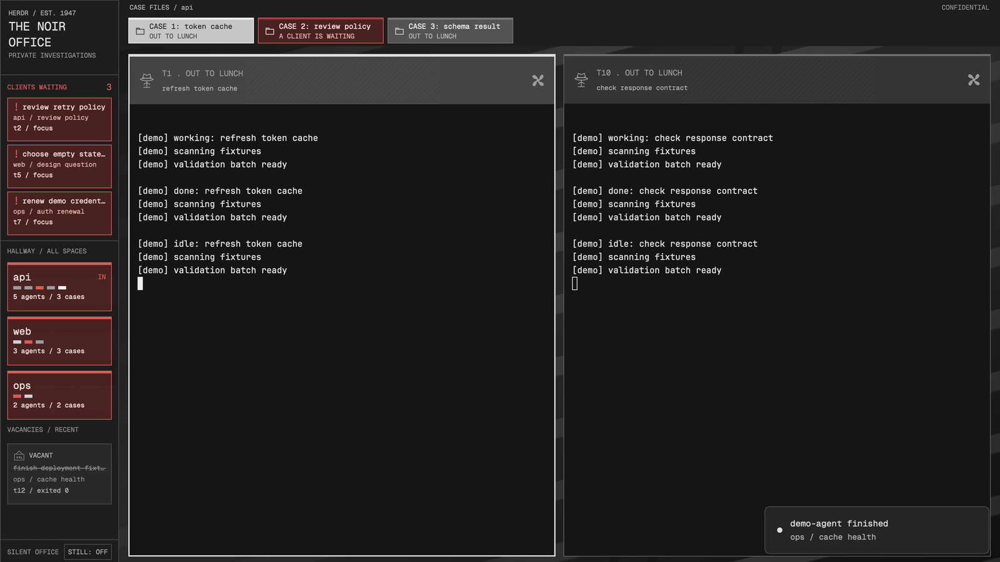

# The Noir Office

A quiet detective office for Herdr app 0.1.7: frosted doors for spaces, case folders for tabs, and venetian blind light behind real terminals. All chrome is grey until somebody needs you. Deep red glass and a permanent, named caller list make that person easy to find, even in another space or a settled tab.

These files are one build of this recipe, enough to rebuild the layout from an empty folder.

## What you see

- A 180px hallway on the left. THE NOIR OFFICE sits above CLIENTS WAITING. Every blocked pane agent and reported child has a caller row with title, space, tab and full address.
- Compact frosted doors below the caller list, one per space, with the space name and small mail slot lights, one per agent. Remote doors also name the machine. Blocked doors and slots turn red. Doors scroll independently of callers.
- A 70px case file strip along the top. Every tab in the selected space is present, including settled tabs. Wide collections scroll horizontally. A grey folder says `CASE 3: <name>`; a blocked folder is red.
- Real terminals in the active tab's split tree. Each has a 74px frosted header: terminal address, lettering, hat stand, the reported task or message, and a ceiling fan. A pale focus border identifies the keyboard target.
- A fixed STILL control at the bottom of the hallway. Recent confirmed exits appear as VACANT cards below the doors; unknown disappearances say `unavailable`. All readable text is at least 10px.

## How it behaves

| State | Visible treatment |
| --- | --- |
| working | Bright lettering and a fan spinning once per 3 seconds. Mail slot is white. |
| done | Native unseen completion says `CASE CLOSED.` with typewriter frames. Looking at it changes it to native idle. |
| needs you | Native blocked, including raw core error, turns glass, folder, hallway door and mail slot red. A thin red line pulses over 1.2 seconds. The pane says `A CLIENT IS WAITING` with the reported msg. Every blocker is also in CLIENTS WAITING. |
| idle | Fan still, dim grey lettering and `OUT TO LUNCH`. A child's raw done becomes idle, never unseen completion. |
| dead | After exit confirmation: faded, struck lettering and a hanging VACANT sign in hallway history. Disappearance alone says `unavailable`. |
| unreported terminal | Header explicitly says `UNREPORTED TERMINAL`; no invented agent state, timing or progress. |

Click a caller row or mail slot to focus that agent with `agent.focus`. A child without a pane opens with `terminal.peek`. Click a door to select its space, a folder to select its tab, or a header to focus its pane/agent. These controls never type answers or approve a request. Existing terminal keyboard bindings stay in force.

Caller rows remain independent of hallway scrolling, tab selection and settled state. With more callers than fit, their own scrollbar leaves the named attention area in place. Agent next/previous navigation follows callers first, then other agents. Long titles are truncated to protect addresses and layout; focus/peek reveals the real terminal.

Task names use the agent title, then its raw report.title joined by address, then program name, then full address. No elapsed-time field is drawn when status_ms is absent; this layout omits elapsed-time UI entirely.

STILL: ON disables fan spins, typewriter frames and red pulses. An inactive window also renders without motion. There is no timer animation. No custom sound is played, so the package cannot double the app's native alert or bypass sounds-off. The package does not change native sound settings.

## Built from

- `layouts/noir.json`: a fixed hallway beside a column containing folder strip and active-tab tree. Terminal opacity is 0.94, pane corners are square, and `mods/noir/blinds.png` is rendered from the original SVG. The system title bar remains available.
- `themes/noir.json`: grey chrome with red blocked status. The 16 ANSI entries are desaturated, keeping small hue differences for diffs. Program-emitted true colour remains the program's own.
- One mod, `mods/noir/`, with roles `hallway`, `folders` and `header`. Without a role it opens the hallway. A fresh install shows an empty hallway, a `NO SPACE` folder strip, and no header until a pane exists.
- `model.js` joins pane agents and raw children by address, preserving machine prefixes. No sequence number is used as identity. History remembers at most 48 observed agents for 24 hours in localStorage: address, title, space/tab names, creation time and last seen time, never terminal output.
- Original SVG art: fan, hat stand, hanging sign, folder, slash frost, blinds and a layout-picker illustration. No external images or fonts. UI uses bundled Geist Mono; terminals use bundled JetBrains Mono. `ASSETS.md` records provenance.
- **Program execution disclosure:** exit confirmation runs `hc ls --all --json` through `exec`, inheriting the app's environment. That list includes connected machines with full `machine/address` identities. Only the hallway polls, at most every 8 seconds while active and only when remembered agents are missing. There is no network request in the mod, and no file read outside its localStorage.
- CLI history rows omit created_ms, so a finished row confirms the remembered full address. If a richer row includes created_ms, it must match. Failure, an explicit incarnation mismatch, an offline machine or a missing record shows unavailable.
- `API-AUDIT.md` maps the API to the frozen guide, declarations and shipped patterns. `node checks/verify.mjs` exercises data and interaction logic offline.

## Watch out

- Only chrome promises red as the sole saturated colour. Programs control their output colours. Blocked red also has explicit text, so colour is never the only signal.
- Native done means completion while unseen. Finishing in a tab already being viewed becomes idle immediately, so a visible working/idle cycle does not demonstrate `CASE CLOSED.`. Live verification of unseen completion and VACANT remains incomplete.
- Exits before the mod observed an agent cannot be reconstructed. A closed pane loses its header, so VACANT lives in hallway history. Listing failures never prove an exit. Timestamp-free listings rely on the core's full address identity.
- The compact height budget allows three callers, three doors and one vacancy in a 900px window. More items or a shorter window require scrolling. Long names require focus/peek to read fully. Native sizing still needs verification on the target display.
- More than 48 simultaneous agents can exhaust remembered history; the live caller list still includes every blocker. A selected theme override can change the intended palette.

## Done when

- JSON, module syntax, SVG and offline state/interaction checks pass.
- `herdr-app check` passes for the installed mod and no configuration error files remain.
- At 1600x900 and 1000x700, hidden, settled, remote and child blockers are discoverable and clickable, with typing focus retained. Check still mode, sounds off, long names, unseen completion and a confirmed exit separately.

## Install

Read the recipe and mod first, including the program execution disclosure. In the chosen app home, create `layouts/`, `mods/` and `themes/` if needed. Copy `layouts/noir.json`, the entire `mods/noir/` directory and `themes/noir.json` into the matching directories. The recipe, checks and root preview are gallery material, not runtime configuration.

Never overwrite an existing name. If `noir` exists, choose a fresh name and update layout/mod/theme names, mod references, asset paths in main.js and the layout, and namespaced storage keys. Check every destination before copying. Preserve settings.json, keys.json, view state and shipped mods.

Run `herdr-app check` for the installed mod, then select `layout.switch {name: "noir"}`. The app's existing environment determines its core connection; the mod does not hardcode a session. Switching layouts preserves the underlying terminals.

## What is faked or missing

- Frost is a flat fill with an original slash SVG overlay, not blur.
- Lettering uses bundled mono faces and silver/white ink rather than downloaded typewriter/serif fonts and gold, keeping chrome monochrome and the package self-contained.
- There is no trumpet asset or custom sound. Native alerts remain the single sound source.
- Native text frames loop, so the typewriter line repeats with a long hold until completion is seen. STILL shows the full line immediately.
- VACANT history substitutes for the removed dead terminal pane. No yes/no controls, model names, invented progress, token counts or costs are shown.
