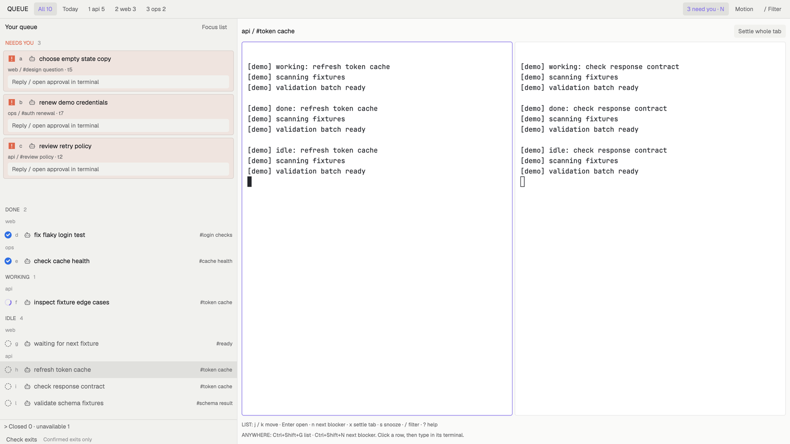

# Queue

Queue puts an urgency-ranked agent list beside the selected tab's live terminals. A permanent Needs you area keeps blockers in view across every workspace, search, Today view, snooze and settled tab. State shapes carry the meaning without relying on colour. It targets herdr-app 0.1.7 with herdr-core 0.1.13.

## What you see

- A 36px top bar has All, Today, workspace chips with counts and keys 1 to 9, the global attention count, a motion switch and a filter control. Chips scroll horizontally when needed.
- The left queue has 30% of the remaining width, minimum 300px. Needs you is a separate, permanently named area with complete titles, workspace, tab, address and child marker. Its own scroll area is independent of the ranked list.
- Done, Working and Idle bands use compact 32px rows: state shape, jump letter, program icon, title, tab and age in state when available. All adds quiet workspace labels. The selected row has a themed highlight. Closed is collapsed at the bottom, with an unavailable count beside it.
- The right 70% shows the active workspace and tab, then that tab's actual split tree. Pane gap 4px, corner radius 4px, hairline borders, no pane headers. A small key guide sits below it.
- Geist for UI, JetBrains Mono for terminals. Paper and Graphite follow appearance; one violet accent (`#8a78e8`) and red-orange attention (`#df674b`) override the theme. All remaining colours use theme tokens. There is no separate theme file. UI text is at least 10px.

## How it behaves

- **Working:** quarter-filled ring spins once per 1.6 seconds, only for working rows and only while the window is active. Still stops the spin. State age reads `terminals().status_ms` joined by address, refreshed every 15 seconds while active. A missing timestamp produces no age text or reserved age box.
- **Done:** filled green circle with a cut-out check. This is the app's native unseen completion; after viewing, the app changes it to idle. Raw child `done` is idle, never a fabricated unseen completion.
- **Needs you:** square with a cut-out exclamation mark, tinted background, bold wrapping title. It precedes all other bands and ignores every filter, snooze and settlement. Core `error` normalizes to blocked. The attention count and next-blocker action are global.
- **Idle:** dashed empty ring and muted row text. Unreported shells have no agent row; their real terminal panes remain in the selected tab.
- **Dead:** a circle with an x and struck title in Closed, only after `hc ls --all --json` explicitly confirms `state: finished`. Disappearance alone is unavailable. A bounded local history remembers up to 64 agents for seven days. Exit checks run at startup, once more after three seconds, on Check exits, and at most every 30 seconds while active. An agent that exits between two checks stays in the Closed count as unavailable until the next check, up to 30 seconds; the gallery capture was taken inside that window and shows unavailable 1 rather than a confirmed exit. Closed starts collapsed; click its toggle to see confirmed exits. Checks that fail, omit the terminal or lose its machine show unavailable. Core history retention can also make an old exit unavailable.
- Click a pane agent or press its jump letter with list focus to run `agent.focus`. This hands typing to the terminal. Children without panes are collected recursively from raw `terminals().parent`; their action is `terminal.peek`.
- Click Focus list to enter list navigation. **j/k** or arrows select; scroll the main list with the wheel or trackpad when needed. **Enter** opens. **n** opens the next blocked agent across all workspaces, including children. It does not use generic `agent.next`. **x** settles the selected agent's entire tab, including its siblings. **s** snoozes a nonblocked agent locally for ten minutes; blockers cannot be snoozed. **1 to 9** select a workspace and its filter. **/** focuses search; Escape clears it. **?** toggles help. Jump letters exclude reserved navigation letters.
- The `keys.json` bindings are optional. Without merging the fragment, clicks and plain keys with list focus still work. With it, **Ctrl+Shift+G** focuses the list from a terminal, **Ctrl+Shift+J/K/N/X/S/F** invoke selection, next blocked, whole-tab settlement, snooze or search, and **Ctrl+Shift+1 to 9** select workspace filters. These layout-scoped bindings replace the same chords' global actions only while Queue shows, including default New space, Open picker and Close pane on N, K and X. Terminal-specific bindings still take priority. Plain letters are never bound globally.
- Today shows global blockers and unseen done. Workspace filters, text search, settled tabs and snooze affect only the lower bands. All clears workspace and Today selection but preserves text search.
- A blocked card's explicit Reply button opens a focused text input. Enter or Send reply sends precisely the text written, only if that target is still blocked. Failed sends preserve the draft. Open terminal handles approvals; there are no Allow/Deny buttons and nothing auto-answers a prompt.
- Queue makes no custom sound. Native Herdr alerts supply the blocked sound and obey the person's sound setting, without a duplicate mod alert. Still and sounds-off are independent.

## Built from

`layouts/queue.json` is a column containing a bar and a 3:7 body row. The list is one block; the work column holds context, `tab: active` and footer. One namespaced mod, `mods/queue`, renders `props().role`: bar, list, context, footer and an explicit reply dialog. This uses the gallery's single-mod role pattern instead of a second queue-bar mod. No shipped mod is modified or copied.

`main.js` uses gpui-kit `View`, div, svg and image plus gpui-base flex, InputState and Input. Ranked rows are direct children of a plain scrolled column, limited to 64 agents after urgency sorting; blockers are never capped. `model.js` contains pure status, filtering and history rules. Titles use the agent title, then the raw terminal report title joined by address, then program name, then address. Five SVG status icons and the settings schematic are original hand-written art. There are no external assets, fonts, network calls or telemetry.

Herdr calls: agents, terminals, spaces, focused, props, theme, window, shared, setShared, run, nextCommand, setAgentOrder, exec, openOverlay and closeOverlay. Commands: agent.focus, terminal.peek, space.select, tab.settle, and namespaced queue commands consumed only by the list copy. Local storage keeps history; shared `queue.ui` keeps filter, Today and still settings. Snooze stays local to the list copy. The app owns the actual agent states.

Programs run, disclosed before installation: `hc ls --all --json` for exit confirmation; `hc send <address> <text>` only after an explicit reply submission. Arguments are passed as an array, never interpolated through a shell. Both inherit the running app's environment and core session. No files outside mod storage are read by the mod. See `API.md` for the source ledger.

## Watch out

Needs you has a separate 290px maximum scroll region, so very many blockers need scrolling inside that area; its heading and count remain visible. Long blocker titles wrap and location text remains present. Compact row titles and top-bar workspace names can truncate; blockers keep the full location and title. The lower bands show at most 64 agents, sorted by urgency before the limit; use workspace and search filters to reach other agents. Direct letters cover the first 20 live rows; j/k continues through the displayed list but does not move its scroll position automatically. Closed starts collapsed and is deliberately bounded; no old terminal is killable or focusable from it.

All five roles have JavaScript render probes for no spaces, no focused tab, zero agents and a 60-character title. Those probes do not verify native layout, GPU rendering, focus transfer or the host's runtime API acceptance. Native checks and live verification of the revised scrolled column remain required.

## Done when

- Every JSON passes `jq empty`; both mod scripts pass `node --input-type=module --check` on stdin. `node --test queue/tests/*.test.mjs` passes model and JavaScript render probes.
- `herdr-app check <app-home>/mods/queue` passes and the app home has no `*.error` file.
- At 1600x900 and 1000x700, use ten generic agents, three blockers (settled and remote included), a child without a pane, an unreported shell, an unseen done and an agent observed before confirmed exit. Find the hidden blocker within two seconds, open it, and retain terminal typing focus. Repeat with long names, sound off and Still on.
- Save an actual 1600x900 layout screenshot as `preview.png` at the package root. Check state changes over a 10 to 20 second recording, including a confirmed exit after opening Closed.

## Install without overwriting

1. Read this recipe, `API.md` and every package file. Choose the target app home. Core operations inherit the running app's session automatically.
2. Refuse installation if either `layouts/queue.json` or `mods/queue` already exists there. Copy only this package's `layouts/queue.json` and `mods/queue/` into its `layouts/` and `mods/`. No theme copy is needed. If renaming, update the layout references, asset paths, queue command prefix, keys section and mod name consistently.
3. Optionally merge `queue/keys.json`, which is a fragment, never a replacement. Back up existing keys first. Merge only its `layout:queue` object into the existing JSON. If that section already has a chord, choose a nonconflicting chord rather than overwriting it. Preserve every other section and binding. The gallery installer does not perform this optional merge; skipping it leaves all click controls and focused-list keys available.
4. Run the native check for `mods/queue`, then select `layout.switch {name: "queue"}`. Inspect the layout at both target window sizes and check for error files.

## What is faked or missing

- `preview.png` is reserved for the actual gallery screenshot. The included settings preview is a labelled SVG schematic.
- No fake live rows or invented agent metrics are rendered. Missing state timestamps have no display; raw child finishes do not become native Done. A confirmed exit requires an agent remembered while live.
- No custom sound, per-pane chrome, generic approval protocol or external assets. Native check and live capture verification remain required for the latest changes; JavaScript tests alone do not establish those results.
